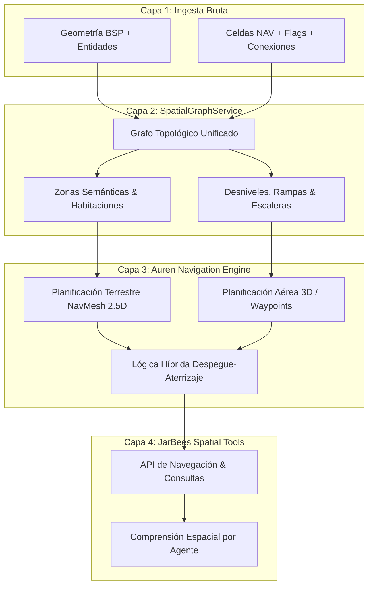

# 🧠 Auren WorldLab: Navegación Espacial Inteligente, Ingeniería Inversa y Grafos Tácticos

> **Documento de Arquitectura y Laboratorio Espacial**  
> **Proyecto:** JarBees: The Game / Auren WorldLab  
> **Área:** Inteligencia Espacial, Cinemática Multimodal, Ingeniería Inversa BSP/NAV  
> **Fecha:** 25 de Octubre de 2026

---

## 🧭 1. El Salto Técnico: De Escenarios Recorribles a Espacios Interpretables

El valor fundamental de incorporar mapas clásicos de Counter-Strike al laboratorio no reside únicamente en la nostalgia ni en disponer de geometrías WebGL adicionales. **El verdadero hito técnico es la recuperación de la información espacial estructurada originalmente para guiar agentes autónomos.**

Este descubrimiento abre la puerta a una transición cualitativa en el desarrollo de JarBees: **pasar de mundos que Auren solo puede recorrer manualmente a entornos cuya topología, conectividad y semántica son comprendidas e interpretadas por un agente autónomo.**



---

## 🏛️ 2. Arquitectura de Navegación en 4 Capas

### Capa 1: Ingesta Bruta (`BSP + NAV`)
* **BSP (Binary Space Partitioning):** Geometría de pinceles compilados, colisiones físicas, caras texturizadas y coordenadas de entidades (spawns, disparadores, luces).
* **NAV (Turtle Rock Studios / Valve Format):** Malla de áreas poligonales 2.5D con cotas de elevación en cuatro esquinas ($z_{nw}, z_{ne}, z_{se}, z_{sw}$), grafos de adyacencia dirigida en 4 ejes cardinales, flags cinemáticas (`CROUCH`, `JUMP`, `PRECISE`) y puntos de cobertura táctica (`Hiding Spots`).

### Capa 2: Servicio de Grafo Espacial (`SpatialGraphService`)
Normaliza la información propietaria de cualquier motor en un grafo agnóstico:
* **Nodos:** Centros y polígonos de celdas con área calculada y vector normal de inclinación.
* **Aristas:** Enlaces orientados con peso de coste (distancia métrica, desnivel vertical, necesidad de salto).
* **Etiquetado Semántico:** Asignación de nombres de zonas (`"Helipad"`, `"Warehouse"`, `"Vent Duct"`, `"Courtyard"`).
* **Tipos de Acceso:** Distinción entre accesos a nivel, pendientes transitables, bordes con caída libre y escaleras verticales de mano.

### Capa 3: Motor Cinemático Multimodal de Auren (`Auren Navigation Engine`)
Auren no es un soldado bípedo estándar: posee capacidades de aceleración Mach, propulsión iónica y vuelo suspendido. El motor planifica en tres modalidades:

| Modalidad | Algoritmo / Modelo | Criterio de Selección |
| :--- | :--- | :--- |
| **Caminar (2.5D)** | $A^*$ sobre NavMesh | Interiores con techos bajos, sigilo, pasillos angostos o ahorro energético. |
| **Volar (3D)** | Raymarching 3D / Octree con evitación de obstáculos | Exteriores, grandes desniveles, simas y desplazamientos de largo alcance. |
| **Híbrida** | Decisión por gradiente de coste energético/tiempo | Despega para sortear abismos o subir pisos; aterriza para atravesar vanos de puerta. |

### Capa 4: Herramientas de Agente (`JarBees Spatial Tools`)
Permite a JarBees (o a modelos de lenguaje acoplados) interactuar con el entorno mediante consultas estructuradas:
```typescript
// Ejemplo de invocación estructurada por el agente
await jarbees.spatial.navigateTo({
  world: "de_vertigo",
  destination: "Bombsite B",
  mode: "hybrid",
  constraints: { avoidFallingEdges: true, maxCeilingClearance: 3.5 }
})

// Respuestas a consultas de razonamiento espacial
const canReach = await jarbees.spatial.checkPath({
  from: "Lower Catwalk",
  to: "Upper Helipad",
  allowLadders: false
}) // -> false (requiere despegue aéreo o escalera)
```

---

## 🔬 3. Casos de Estudio: Vertigo como Laboratorio de Verticalidad Extrema

El escenario `de_vertigo` (562 áreas NAV, 173,979 $\text{m}^3$ de caja envolvente) ofrece un campo de pruebas idóneo para:
1. **Detección de Bordes y Precipicios:** Las vigas perimetrales y vanos abiertos hacia el vacío permiten entrenar los sensores de colisión anticipada (GCAS - *Ground Collision Avoidance System*) de Auren.
2. **Vuelo entre Estructuras:** Algoritmos de navegación para atravesar huecos de ascensor y encofrados metálicos sin impactar con las vigas de sustentación.
3. **Validación de Villa Auren:** La conexión entre las dos plantas de Vertigo (piso 50 y 51) mediante rampas y huecos abiertos sirve de referencia directa para optimizar el atrio central de las tres plantas de Villa Auren.

---

## 📐 4. Precisiones Técnicas y Corrección de Métricas

Para mantener la rigurosidad científica del laboratorio, se documentan las siguientes correcciones de análisis:

### A. Naturaleza del Checksum en el Header `.nav`
* **Corrección:** El campo de 4 bytes tras la versión en el header `.nav` almacena el tamaño en bytes del archivo `.bsp` (`bspSize`), no un hash criptográfico de contenido (como MD5 o SHA-256).
* **Implicación:** Dos archivos BSP con idéntico recuento de bytes pero con modificaciones internas menores no invalidarían el NAV de forma garantizada. Sin embargo, sirve como un control de consistencia ágil en tiempo de carga del motor original.

### B. Geometría Jugable vs. Bounding Box Global
* **Límites Globales:** Los vértices del archivo BSP abarcan toda la caja del mundo (*world bounds*), incluyendo el skybox lejano, áreas de vacío inaccesible y entidades de control situadas fuera del mapa.
* **Cálculo de Volumen Útil:** El volumen transitable real debe obtenerse mediante la sumatoria del área bidimensional de los polígonos del NavMesh multiplicada por la altura libre hasta el techo más cercano, en lugar del producto rectangular exterior ($X \times Y \times Z$).

### C. Convención de Escala
* **Factor adoptado:** $1\text{ unidad GoldSrc} = 0.0254\text{ m}$ (1 pulgada internacional).
* **Observación ergonómica:** Si bien $0.0254\text{ m/u}$ es una convención precisa y reproducible para el pipeline de exportación a Blender y Three.js, las proporciones de los mapas clásicos fueron diseñadas con sesgo de jugabilidad (jugador de 72 unidades $\approx 1.83\text{ m}$, pero puertas y pasillos sobredimensionados a 128 unidades $\approx 3.25\text{ m}$ para permitir el cruce fluido de dos personajes con armas). En Villa Auren se equilibran estas medidas con proporciones arquitectónicas realistas.

---

## 🛠️ 5. Hoja de Ruta: El "NAV Debugger" de Auren WorldLab

El siguiente experimento prioritario consiste en implementar un **depurador visual de navegación tridimensional** en tiempo real:

```
+--------------------------------------------------------------+
|                     AUREN NAV DEBUGGER                       |
|  [✓] Show Areas (Polys)    [✓] Show Connections (Arrows)     |
|  [✓] Show Hiding Spots     [✓] Show Height Gradients         |
|  Active World: de_vertigo        Selected Node: Area #142    |
|  Flags: [CROUCH: NO] [JUMP: YES] [PRECISE: YES]              |
|  Connections: N->#143, E->#150, S->#120, W->[DROP_EDGE]      |
+--------------------------------------------------------------+
```

### Capacidades del NAV Debugger:
1. **Superposición Wireframe / Semitransparente:** Dibuja las celdas cuadriláteras del NAV directamente sobre la malla GLB con código de colores según sus flags cinemáticas.
2. **Vectores de Conexión:** Flechas 3D que muestran el flujo de movimiento posible entre áreas, destacando desniveles críticos y bordes sin retorno.
3. **Trazado de Rutas Interactivas:** Selección de nodo origen y destino con visualización instantánea de la ruta $A^*$ terrestre versus la trayectoria spline de vuelo de Auren.
4. **Universalidad para Villa Auren:** El depurador estará desacoplado del formato GoldSrc, permitiendo auditar tanto los mapas clásicos analizados como el sistema de navegación propio que se desarrolle para la residencia principal de Auren.

---

## ⚖️ 6. Política de Seguridad y Propiedad Intelectual

1. **Laboratorio de Investigación Privado / Local:**
   * Los mapas compilados de *Counter-Strike* (`de_vertigo`, `cs_assault`, etc.) y sus archivos `.nav` se utilizan exclusivamente de forma local como entorno de prueba comparativo e ingeniería inversa bajo fair use de investigación.
   * Están excluidos del control de versiones público y de los despliegues de producción en GitHub Pages.
2. **Assets Públicos y Despliegues en Producción:**
   * La versión pública del proyecto incluirá únicamente geometría original (Villa Auren, Templo de Keops) y escenarios comunitarios con licencia abierta o de dominio público (CC0 / Kenney / Quetoo / Squall Open Source).
