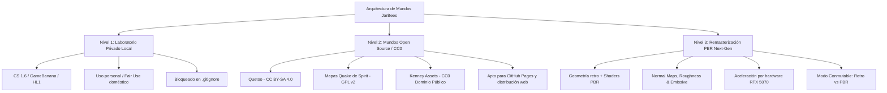

# 🗺️ Hoja de Ruta e Investigación: Mapas Open Source y Remasterización PBR

> **Documento de Investigación Técnica y Arquitectura**  
> **Proyecto:** JarBees: The Game  
> **Hardware de Referencia:** NVIDIA GeForce RTX 5070 (Arquitectura Blackwell)  
> **Framework:** Next.js 14 + React Three Fiber (Three.js r170)

---

## 🎯 1. Visión y Estrategia: Arquitectura en Tres Niveles

Para disfrutar de la rica historia del diseño de niveles FPS clásico sin comprometer la seguridad jurídica en despliegues públicos (como **GitHub Pages**), se establece una arquitectura segmentada en **tres niveles de mundos**:

---

## 📚 2. Fuentes de Mapas Abiertos para Exploración Pública

### A. Quetoo (FPS Open Source - La Mejor Alternativa a CS/Quake)
- **Licencia:** **CC BY-SA 4.0** (assets, mapas, modelos y texturas) / **GPL v2+** (código fuente).
- **¿Por qué es ideal?**:
  - Quetoo es un shooter en primera persona de código abierto diseñado específicamente para continuar la estética y jugabilidad clásica de Quake II / QuakeWorld con tecnología moderna.
  - Los mapas están completamente disponibles con sus archivos fuente originales, lo que permite inspeccionarlos, decompilarlos o recompilarlos legalmente.
  - Incluye mapas urbanos, industriales, castillos y arenas de salto/vuelo de altísima calidad artística.
- **Enlace de Investigación**:
  - Repositorio oficial de mapas: `github.com/jdolan/quetoo-data` / `quetoo.org`
- **Requisitos de Cumplimiento**:
  - Mantener atribución visible de los mappers en el HUD (`CC BY-SA 4.0`).
  - Distribuir las modificaciones bajo la misma licencia o compatible.

---

### B. Colección de Mapas Quake de Spirit (Archivos Fuente `.map`)
- **Licencia:** **GPL v2**.
- **Características**:
  - Repositorio que preserva decenas de archivos fuente `.map` históricos de la comunidad de Quake.
  - Al disponer de los archivos `.map`, pueden abrirse directamente en herramientas modernas como **TrenchBroom** o **NetRadiant-custom**.
- **Estrategia de Integración**:
  - Sustituir las texturas de id Software (que tienen derechos reservados) por atlas de texturas libres (como las de Quetoo o texturas PBR CC0).
  - Exportar la geometría limpia a `.obj` o `.glb` mediante TrenchBroom -> Blender.

---

### C. Ecosistema Kenney (Dominio Público - CC0)
- **Licencia:** **CC0 1.0 Universal (Dominio Público)**.
- **Ventajas**:
  - **Cero restricciones legales:** Se pueden modificar, convertir, empaquetar, comercializar o alojar en GitHub Pages sin necesidad de créditos obligatorios.
  - **Modularidad:** Dispone de kits modulares de plataformas espaciales (*Space Kit*), castillos medievales (*Castle Kit*), ciudades modernas y complejos subterráneos.
  - Formato nativo en GLTF/GLB de bajo conteo poligonal, ideal para carga instantánea en WebGL móvil.

---

## 🎨 3. Remasterización PBR (Geometría Retro + Shaders Modernos)

Aprovechando la potencia de cálculo y memoria de la **RTX 5070**, se investigará un sistema de **remasterización en tiempo real** que mantenga la silueta retro de los mapas pero eleve los materiales al estándar visual contemporáneo:

### Componentes del Pipeline PBR:
1. **Generación Automatizada de Mapas Normales & Rugosidad**:
   - Crear un script en Python/Node que tome las texturas difusas de 64x64 o 128x128 y genere:
     - **Normal Map (Tangente)**: Para dar volumen a adoquines, ladrillos, baldosas y ranuras metálicas.
     - **Roughness Map**: Separar materiales mates (hormigón, tierra) de materiales reflectivos (charcos de agua, baldosas pulidas, metales).
     - **Metallic Map**: Reflejos nítidos en barandillas, planchas de acero y tuberías.
     - **Emissive Map**: Para pantallas, luces fluorescentes de almacén y faroles.

2. **Iluminación y Post-Procesado Avanzado en Three.js**:
   - **Ambient Occlusion en Espacio de Pantalla (SSAO)** o AO precalculado por vértice en Blender.
   - **Screen Space Reflections (SSR)**: Reflejos en tiempo real sobre charcos de agua y baldosas de piscinas (como en *Pool Day* o los canales de *Aztec*).
   - **UnrealBloomPass**: Resplandor dinámico en lámparas y fuegos de boquilla.
   - **Volumetric Light Shafts**: Rayos de sol crepusculares entrando por tragaluces y ductos de ventilación.

3. **Modo Conmutable en Tiempo Real (`[F7] Toggle PBR Remaster`)**:
   - Permitir al jugador alternar instantáneamente entre:
     - **Modo Clásico 1999**: Texturas filtradas bilineales / punto, sombreado plano simple.
     - **Modo Remasterizado 2026**: Materiales `MeshStandardMaterial` / `MeshPhysicalMaterial`, reflejos especulares PBR y luces puntuales reactivas.

---

## 🛠️ 4. Herramientas Recomendadas para la Conversión

| Herramienta | Rol en el Flujo | Licencia |
| :--- | :--- | :--- |
| **TrenchBroom** | Editor de niveles moderno para Quake/GoldSrc; exportación directa a `.obj` | GPL v3 |
| **Blender 5.x** | Limpieza de geometría, cálculo de UVs secundarias y exportación a GLB | GPL v3 |
| **fastbsp / bsp2gltf** | Conversores directos de BSP a GLTF por línea de comando | MIT |
| **Material Maker** | Generación procedural de texturas PBR y mapas normales a partir de imágenes base | MIT |

---

## 📋 5. Próximos Pasos cuando se retome la investigación
- [ ] Clonar el repositorio `quetoo-data` e inspeccionar 2 mapas emblemáticos en TrenchBroom.
- [ ] Construir un prototipo de prueba en Blender aplicando Normal Maps y Roughness a las texturas de adoquines de un mapa pequeño.
- [ ] Diseñar un escenario de prueba modular CC0 con assets de Kenney para el despliegue permanente en GitHub Pages.
- [ ] Integrar el toggle de sombreado Retro/PBR en el menú de ajustes gráficos de JarBees.
